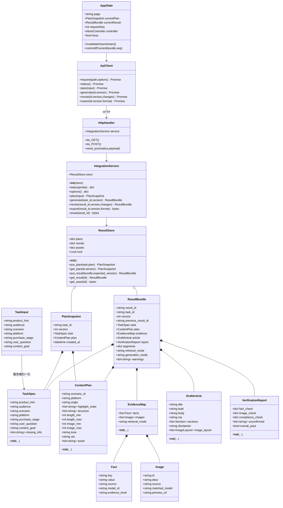
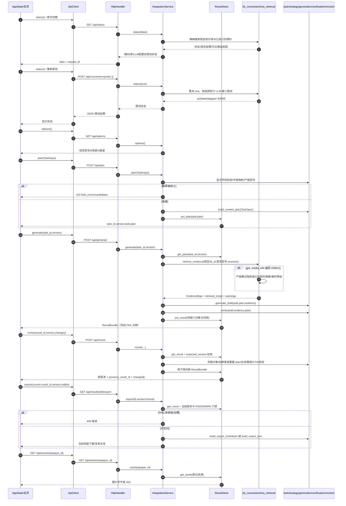
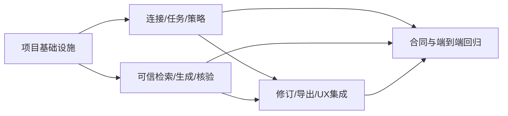

# 前后端集成系统设计（增量 P0）

依据 `docs/incremental-prd.md`；本设计只描述目标契约，不声称线上 ima 或 LLM 已实测。保留 `frontend/` 原生 JS 五页 Hash SPA 与 `agent/layers/`，不重写 React。正式模式以真实 ima 为唯一在线事实源；`local_index` 仅能明确标识为本地镜像演示；前端 Mock 默认不参与业务响应。

## Part A：系统设计

### 1. 实现方案

**难点与选择。** 采用 Python 标准库 `ThreadingHTTPServer` + `BaseHTTPRequestHandler` 托管同源静态资源和 `/api/`，一个纯服务层编排现有 `TaskSpec → ContentPlan → EvidenceMap → DraftArticle → VerificationReport`。不引入 FastAPI、React 或数据库：本机单实例、轻量 JSON/二进制接口足够；保留现有 `PyYAML` 策略配置、Node ima 脚本。服务端进程内 `ResultStore` 使用 UUID、锁及不可变快照持有计划与结果；重启后 ID 失效并返回明确 404。服务器绑定 `127.0.0.1`，禁止任意文件路径、外部 URL 代理和跨域请求；所有密钥只在 Python 进程环境加载。

**分层。** 前端 `api-client.js` 管 HTTP、超时、错误结构和 AbortController；`app.js` 管单一当前会话、请求序号和五页 UI；服务端 `http_server.py` 仅路由/反序列化/状态码，`integration_service.py` 承担规则、编排、版本门禁，`serializers.py` 显式输出白名单字段，`result_store.py` 存快照/资源映射。`agent/layers` 继续是业务模型。HTTP 成功表示请求成功，不表示核验成功；`FAIL` 随完整 `ResultBundle` 返回 200 以供诊断，但导出必由服务端拒绝。线上查询不得因 ima 失败静默改用 Mock；fallback 必须有 `retrieval_mode` 和 `fallback_reason`。

**前端三文件修改边界。** `frontend/js/api-client.js` 是唯一 HTTP 边界：封装同源 `fetch`、JSON 成功/错误解析、超时/取消、各业务接口及 MD/TXT 获取；不保存页面状态、不生成业务事实、不引用 `HWMock`。`frontend/js/app.js` 保留 Hash 路由、DOM 渲染及事件，移除 `M.buildContentPlan/buildEvidence/buildArticle/buildVerification/articleToMarkdown/articleToPlain` 等业务调用，改为等待接口同版结果；维护 busy、requestSeq、task/result/version，输入变更即失效下游，`finally` 释放遮罩。`frontend/js/mock-data.js` 仅保留明确标注的离线演示展示数据，正常入口不加载；显式 `?demo=1` 也不得覆盖真实 API 失败或伪装后端成功，演示来源必须可见。纯 UI 常量迁移至 `app.js` 或使用 `/api/options`，不能因复用常量继续依赖 Mock 业务生成器。

**连接/检索真实边界。** `check_knowledge_base()` 当前把搜索第一项当目标、且失败自动回本地，不能直接作为真实探测结论。新增精确名称/预配置 ID 核对，读取 ima 响应 `code` 并记录真实 `search_knowledge_base`、针对锁定 ID 的 `search_knowledge` 探针；未执行的 `get_media_info`/LLM 仅写 `skipped`。独立 LLM 探针按实际模型发最小请求并有超时/耗用提示；若用户不触发探针则 `configured` 不是 `reachable`。当前 `generate_draft()` 是模板，`generation_mode=template`，不因 LLM 已配置而标记 `llm`。连接状态区分 `connected`、`local_index`、`failed`，前端展示探测时间、掩码、锁定库名/ID、每项耗时与失败建议。

**ima 配额。** `search_knowledge` 命中只代表摘要，不能冒充原文/图片。对命中 `media_id` 尝试 `get_media_info` 并仅解析成功且可授权读取的资源；返回 `code=220021` 时记录 `quota_exhausted` 探针、保留 ima 摘要为摘要而非已核实完整规格；按配置可切换已严格匹配型号的本地镜像/已取得且带同型号和来源的缓存，`retrieval_mode=local_index|cached_mirror`、`fallback_reason=ima_media_quota_220021`，绝不称在线图片。正式 `IMA_MODE=strict` 则阻断需要媒体证据的生成。`get_media_info` 的 `url_info.headers` 可能含授权，绝不序列化到浏览器；服务端只接受锁定结果资源的 opaque `asset_id` 并在可控条件下读取镜像或暂存二进制。无可验证 URL/图像时 `images=[]`，如实提示及核验图片不足；不能以 ima 摘要、`ima://`、占位图或他机型图片充数。缓存应标明采集源、时间、型号，不存在则不能造缓存。

**型号与事实可信度。** `/api/options` 读取真实产品目录并返回规范产品 ID/路径对应展示名；归一化可处理空格大小写，但禁止 `find_product_dir()` 当前字符重合评分自动选最相近。0 命中 422 `UNKNOWN_PRODUCT`，多版本命中 422 `AMBIGUOUS_PRODUCT` 附候选；1 个确认型号才可检索，本地图片 `matched_model` 取该目录规范型号而非用户原输入。ima 结果也按标题/原文可确认型号筛选，不可验证的摘要不产生精确配置事实。生成层删除小红书固定 `HarmonyOS 6`、`麒麟 X90`、`70 Wh`、重量、存储等缺项回填；缺证据则中性描述并标待确认，不得创造规格。`verify()` 必须执行而非默认为真：扫描 title/lead/body/cta 的数值、型号、动态促销及禁词，核对图片 ID/型号/数量、免责尾句。无法核查是 FAIL，不是 PASS；所有检查通过且无待确认是 PASS；无失败且未将待确认信息写成承诺是 WARN；任何核验失败是 FAIL。原有 `overall_pass` 只代表三项布尔汇总，适配时结合完整执行标记和未确认项映射，不能简单将 `True` 映射 PASS。

**状态与版本。** 计划创建生成 `task_id` 和版本 `1`；服务端仅接收 `{task_id,version}`，计划快照不能由前端篡改。结果持有 `result_id`、`task_id`、单调 `version`、`previous_result_id` 以及 task/plan/evidence/article/report/segments 同版快照；修订必须携带结果 ID 与 expected version，经锁检查，复制 task/plan/evidence，仅换渠道时重建 plan，并重跑层 5→6。精确删除当前稿最后一个可编辑正文段，保留不可删免责句；删段单独操作直接对当前稿克隆执行，组合修订先锁定原段 ID，再于生成结果中排除该段且不重新补回；若无段可删返回 422 `NO_EDITABLE_SECTION`。highlight 允许 `battery|screen` 对应原控件续航/屏幕，实质调整 plan 优先级与正文顺序，但没有相应事实时不得补数值。自定义 CTA 原样保留并核验；高危价格承诺 FAIL。修订失败业务稿生成新诊断版本但不能导出，异常则当前成功版本不变。复制/下载永远从服务器当前结果 ID 取 TXT/MD；导出还要求该 ID 对应未过期 task 的当前版本、完整 report 且 `overall in {PASS,WARN}`。WARN 导出明确待确认与来源模式，FAIL/未核验返回 409。

### 2. 文件清单（相对仓库根目录）

| 文件 | 职责 |
|---|---|
| `requirements.txt`（新） | 声明运行时 PyYAML 依赖 |
| `agent/integration_config.py`（新） | 读取并验证模式、锁定库、服务端口及超时配置；默认仅允许本机连接 |
| `agent/http_server.py`（新） | 同源静态/API 路由、JSON 限制、状态码及二进制资源发送；启动入口 `python -m agent.http_server` |
| `agent/integration_service.py`（新） | 连接探测、输入归一化/严格型号、plan/generate/revise/export 编排与 fallback 门禁 |
| `agent/result_store.py`（新） | 进程内带锁的 plan/result 版本快照与仅结果关联的资源映射 |
| `agent/serializers.py`（新） | TaskSpec/ContentPlan/EvidenceMap/DraftArticle/VerificationReport 白名单 JSON、四段与 PASS/WARN/FAIL |
| `agent/layers/kb_connection.py` | 精确锁库、错误码及逐项真实探针；不返回原始上游响应或绝对路径 |
| `agent/layers/task_understanding.py` | 显式字段优先，中文场景/渠道映射与必填问题 |
| `agent/layers/scenario_strategy.py` | 保持 YAML 策略，拒绝未知枚举 |
| `agent/layers/ima_retrieval.py` | 严格型号；ima 媒体取证、220021 配额降级、镜像/缓存与真实图片来源 |
| `agent/layers/article_generation.py` | 基于证据生成，去固定参数；支持段落边界及真实图片数 |
| `agent/layers/verification.py` | 逐段事实/型号/图片/CTA 核验，缺证据与检查失败不默认成功 |
| `agent/layers/revision.py` | 无原地突变的结构化修订，MD/TXT 同版输出和核验摘要 |
| `frontend/index.html` | 删除默认已连/假探测文案，补状态、来源、图片、错误及版本信息节点 |
| `frontend/js/api-client.js`（新） | fetch 同源接口、AbortController、错误和下载 |
| `frontend/js/app.js` | 五页请求/渲染、单会话版本、失效门禁、禁重复提交与终于关闭遮罩 |
| `frontend/js/mock-data.js` | 仅显式 `?demo=1` 可读的演示展示素材，不参与普通接口业务 |
| `frontend/css/styles.css` | 连接/警告/失败/图片缺失/加载响应式状态 |
| `tests/test_integration_service.py`（新） | 任务枚举/型号/证据、220021、核验/修订/导出版本单元测试 |
| `tests/test_http_api.py`（新） | 所有 HTTP 接口、错误、资源白名单与服务未就绪测试 |
| `tests/test_frontend_flow.mjs`（新） | 使用 Node 内置测试能力与 DOM/fetch stub 验证前端契约；真实浏览器五页及四渠道另做人工验收 |
| `docs/integration-architecture.md` | 本架构与任务交接；与 `docs/system_design.md` 内容一致 |
| `docs/system_design.md`（新） | 统一系统设计文件 |
| `docs/class-diagram.mermaid`、`docs/sequence-diagram.mermaid` | 从本文提取的独立图文件 |

### 3. 数据结构及接口

**DTO 适配。** `serializers.py` 将后端 `product_hint/user_question` 映射为前端任务的 `product/query`（提交使用 `TaskInput` 规范名）；场景与渠道根据 `/api/options` 的 `{id,label}` 展示，内部保留英文值。计划保留 `image_min/image_max`，前端显示区间，不能把两者错误折成实际图片数；实际数只取 `evidence.images.length`。图片布局 `position` 统一为前端 `pos`，所有 source 序列化为可读来源标识，磁盘路径不出站。`unconfirmed:string[]` 转为 `{field:'待确认',reason:string}[]`；报告检查项统一 `{pass:boolean,executed:boolean,issues:string[]}`。`overall_pass=true` 必须再满足检查执行完整、无失败及无待确认才能映射 PASS，有安全保留的待确认映射 WARN，检查未完成或存在失败映射 FAIL。`article.sections` 使用 `{id,text,fact_ids:string[]}[]`，`disclaimer` 单列，`body` 由 sections 派生，防止删段操作误删免责。

**HTTP 契约。** JSON 响应成功为 `{data,request_id}`，错误为 `{error:{code,message,field_errors?,retryable,candidates?},request_id}`；`Content-Type: application/json; charset=utf-8`；固定 body 大小上限（如 64 KiB）、结构白名单与字符串长度上限。`GET /api/status`、`POST /api/connection/probe`（body `{}`，不接受密钥）、`GET /api/options`、`POST /api/plan` body `{task:TaskInput}`、`POST /api/generate` body `{task_id,version}`、`POST /api/revise` body `{result_id,version,changes:{delete_last_section:boolean,platform?:'xhs'|'wechat_mp'|'moments'|'poster',highlight?:'battery'|'screen',cta?:string}}`、`GET /api/results/{id}/export?format=md|txt&version=N`、`GET /api/assets/{opaque_id}`。下载返回受控 `Content-Disposition`、UTF-8 编码；资源只允许结果快照登记的图片 ID，禁止路径参数穿透。`GET /api/options` 由 YAML 与已索引本地产品生成选择值/中文标签；中文别名仅输入边界转换，内部一律英文 ID。

`GET /api/status` 数据样例：`{account:{client_id_masked,configured},kb:{name,id,connection},llm:{configured,probe_status,provider,model},checked_at,probes:[{name,status:'ok|failed|skipped',duration_ms,detail}],allowed_mode:'strict|local_demo',fallback_reason}`。未发 LLM 探针 `probe_status=skipped`，不能把已配置说成已连通。`POST /api/plan` 返回 `{task_id,version,task,plan}`，缺项 422 `{field_errors:[{field,question}]}`。`POST /api/generate` 返回 `{result_id,task_id,version,previous_result_id:null,task,plan,evidence:{facts,images,retrieval_mode},article,report:{overall:'PASS|WARN|FAIL',fact_check,image_check,compliance_check,unconfirmed},segments:{场景判断,知识库依据,图文软文,核验结果},retrieval_mode,generation_mode,warnings}`；四段由同一快照格式化。`POST /api/revise` 相同完整结果包，另有 `changed[]`。图片对象 `preview_url` 只由已校验 opaque 资源生成；无图片返回空数组。

服务端错误映射：400 JSON 无效/方法不支持；422 缺项、枚举、型号未知/歧义、无可删段（提供 candidates/field_errors）；404 ID/资源已失效；409 版本过期或失败稿导出；503 ima/LLM/本地资源不可用；504 服务端上游超时。浏览器请求超时不代表服务端任务停止；客户端 Abort 后必须用序号/版本防止迟到结果覆盖。不得把异常原文、凭证、绝对磁盘路径放入响应。

### 4. 关键调用流程

### 5. 不明确项与假设

- 正式验收是否必须全线上 ima：本设计默认 `IMA_MODE=strict` 不用本地回退做正式通过；`IMA_MODE=local_demo` 时可以镜像/缓存，UI 与导出强制明显标注。需最终确定验收口径。
- 指定 ima 库的准确名称/ID 以服务端环境配置及**精确命中**为准；多项同名时要求预设 ID，不能首项自动锁定。
- 当前默认 `MateBook X Pro 2024` 可能与真实目录不唯一；推荐清空默认产品或由 `/api/options` 返回的明确型号填入，不以 Mock 缺省值保证成功。
- `get_media_info` 只一定返回媒体访问信息，是否含在线图像二进制取决于实际媒体类型与可访问 URL；在线图片不足可导致 WARN/FAIL，不能承诺必有图。
- 生成暂保留模板，不承诺已使用 LLM；连接页 LLM 实际探针和生成模式分别显示。
- 并发仅本地单进程多线程；没有持久化/跨重启恢复，服务重启返回 404 并引导重建计划。

## Part B：工程任务拆解

### 6. 必需包

- `PyYAML>=6,<7`：现有 `scenario_platform_strategy.yaml` 解析依赖。
- Python 3.10+ 标准库：`http.server`、`threading`、`dataclasses`、`json`、`uuid`、`urllib`、`unittest`，无需额外 Python Web 依赖。
- Node.js（仓库已有 `ima_api.cjs` 所需运行时）：已有 ima CLI 桥接，不新增 npm 包。
- 不新增第三方包。Python 测试使用 `unittest`/`unittest.mock` 和 `urllib.request`；前端契约测试使用 Node 内置 `node:test`、`assert` 和 fetch/DOM stub；浏览器人工覆盖五页流程。`requirements.txt` 只记录仓库已使用的 PyYAML，不引入新依赖。

### 7. 任务（最多 5 项；每项至少 3 个相关文件）

| ID / 优先级 | 模块任务 | 修改/创建文件 | 依赖 | 验收重点 |
|---|---|---|---|---|
| T01 / P0 | 项目基础设施（配置文件 + 入口文件 + 依赖声明） | `requirements.txt`, `agent/integration_config.py`, `agent/http_server.py`, `agent/integration_service.py`, `agent/result_store.py`, `agent/serializers.py`, `frontend/js/api-client.js`, `frontend/index.html` | 无 | 同源启动命令、基础路由/错误约定、仅本机服务、静态/密钥隔离、版本快照可用 |
| T02 / P0 | 连接、选项、任务与策略 | `agent/layers/kb_connection.py`, `agent/layers/task_understanding.py`, `agent/layers/scenario_strategy.py`, `agent/integration_service.py`, `frontend/js/app.js`, `frontend/index.html` | T01 | 真探针、LLM 配置与探测区别、中文映射/必填/歧义型号/完整 plan；5页门禁初步接通 |
| T03 / P0 | 可信检索、生成和核验 | `agent/layers/ima_retrieval.py`, `agent/layers/article_generation.py`, `agent/layers/verification.py`, `agent/integration_service.py`, `agent/serializers.py`, `frontend/js/app.js`, `frontend/css/styles.css` | T01 | 220021 标记镜像降级、零图片诚实、无固定参数、完整同版结果包、PASS/WARN/FAIL 严谨 |
| T04 / P0 | 修订、下载和五页 UX 集成 | `agent/layers/revision.py`, `agent/integration_service.py`, `agent/result_store.py`, `frontend/js/api-client.js`, `frontend/js/app.js`, `frontend/index.html`, `frontend/css/styles.css`, `frontend/js/mock-data.js` | T02、T03 | 四类真实修订，换渠道重建策略，删段留免责，CTA 核验，导出门禁，同版预览/复制/MD/TXT，错误/超时不假成功 |
| T05 / P0 | 合约与端到端回归 | `tests/test_integration_service.py`, `tests/test_http_api.py`, `tests/test_frontend_flow.mjs`, `frontend/js/app.js`, `agent/integration_service.py` | T02、T03、T04 | 四渠道、五修订项、未知/歧义型号、220021、无图、假规格/999元/国补 CTA、失败禁止导出、版本竞态与断连 |

T02/T03 仅共同依赖 T01，可以并行；T04 集成二者。T05 负责整体验收而非引入新功能。

### 8. 共享约束

- 后端内部所有枚举为 `school_season|business_office|content_creation|family_refresh|enterprise_procurement|store_visit|new_launch|holiday` 和 `xhs|wechat_mp|moments|poster`；中文只在选项展示/输入边界转换。
- JSON 统一 `{data,request_id}` 或 `{error,request_id}`；HTTP/上游 `code=0` 不是事实核验结果；所有时间 ISO 8601 UTC，在 UI 本地化。
- `TaskSpec` 显式人群/目标/阶段不得被旧 `parse_task()` 默认覆盖；必须字段缺失阻断，场景建议追问不得对已完整输入无限循环。
- 业务快照及资源关联必须不可变且同版；任何编辑使下游计划/稿件失效，迟到响应按 `requestSeq`、task ID 和 version 丢弃。
- 前端所有动态字符串使用 `textContent`/HTML 转义，`img src` 只使用后端受控 URL；导出由服务端再次核验/门禁。
- `retrieval_mode` 与 `generation_mode` 分离；本地镜像演示不能标成 ima 在线取证；未真正执行的探针不能标成功；未核验不能映射 PASS。
- 不保存、记录或返回 API Key、上游授权头、完整上游响应、本地绝对路径；失败提示含可行动步骤但不泄密。

### 9. 任务依赖图

